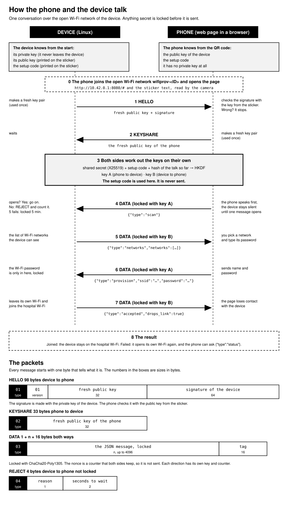
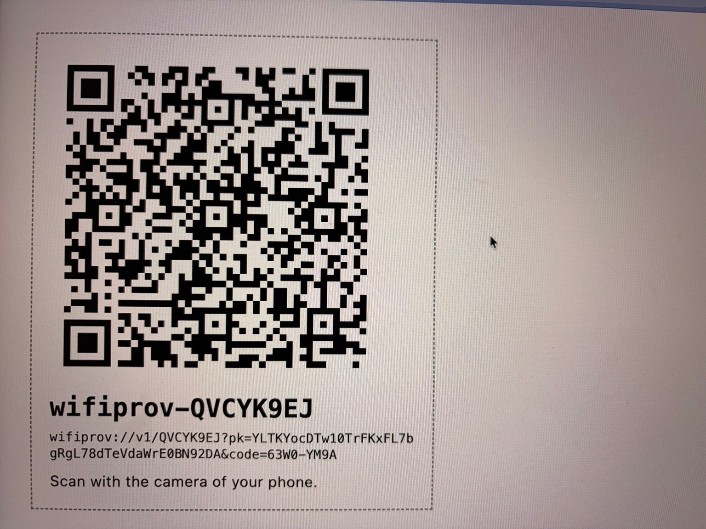
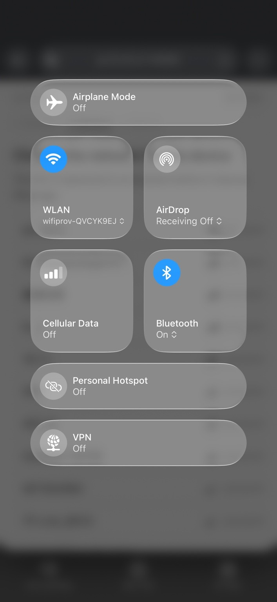
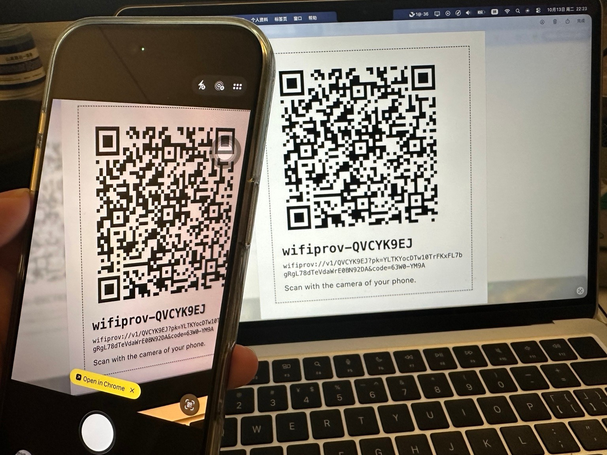
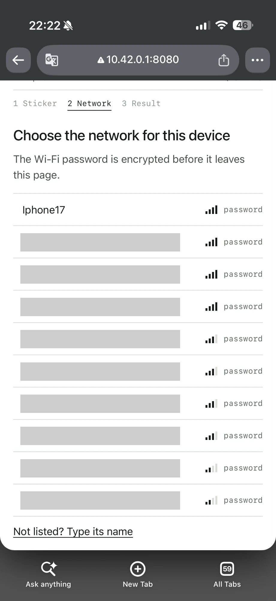
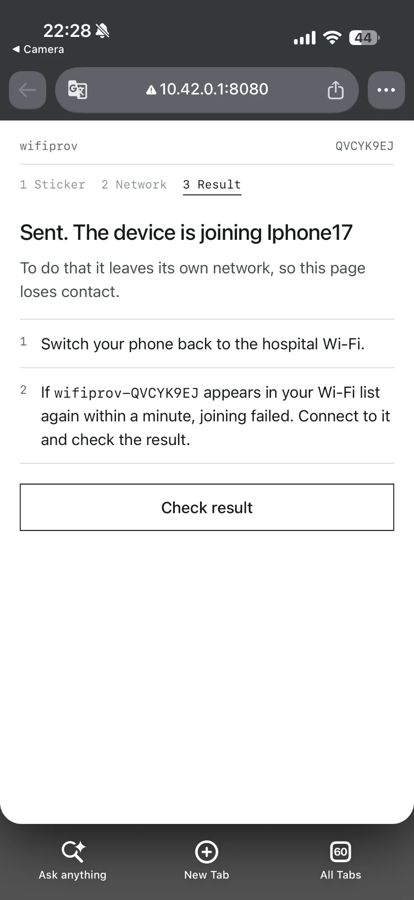
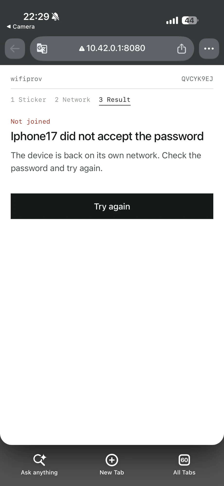
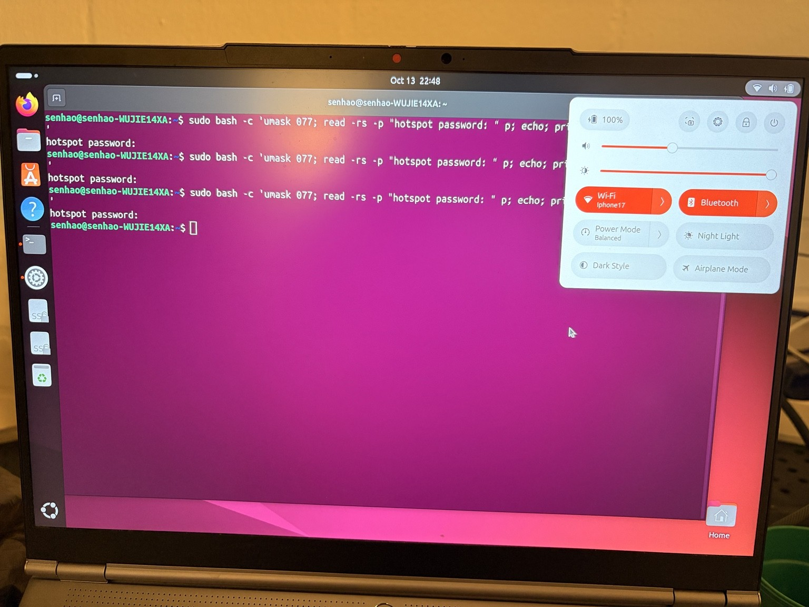

# Architecture

This document shows how the system works. It has a real run with photos and screenshots, and the trade-offs I made. It answers the three questions of the challenge. Why this channel? How is the Wi-Fi password protected? What changes for 200 devices?

1. [The idea in one picture](#1-the-idea-in-one-picture)
2. [A real run, step by step](#2-a-real-run-step-by-step)
3. [Why this channel, and what I gave up](#3-why-this-channel-and-what-i-gave-up)
4. [How the Wi-Fi password is protected](#4-how-the-wi-fi-password-is-protected)
5. [What changes for 200 devices](#5-what-changes-for-200-devices)
6. [Assumptions](#6-assumptions)
7. [Limitations](#7-limitations)

## 1. The idea in one picture

A new device has no network. You stand next to it with a phone. The two must talk without the internet, and nobody who listens may read the Wi-Fi password.

My answer is this. The device opens its own small Wi-Fi network for 10 minutes. The phone joins it and opens a web page that the device serves. The page and the device agree on a secret key. The Wi-Fi password goes to the device locked with that key. Then the device leaves its own network and joins the hospital Wi-Fi.

How to read the figure:

- **The sticker.** Every device has a sticker with a QR code. It holds the public key of the device and a setup code. The public key lets the phone check that it talks to the right device. The setup code shows that you are standing next to it.
- **Steps 1 to 3** make the keys. The setup code goes into the keys. It is never sent.
- **Steps 4 to 7** are the real work. The phone speaks first. The Wi-Fi password is only in step 6, and it is locked.
- **Step 8.** If the join fails, the device opens its own network again and the phone can ask why.
- **The packets** at the bottom show the bytes. [PROTOCOL.md](PROTOCOL.md) describes them byte by byte.

## 2. A real run, step by step

I ran the whole flow on real hardware.

- The device is a laptop with Ubuntu 24.04 and an Intel AX200 Wi-Fi adapter.
- The phone is an iPhone with Chrome.
- A second phone made a hotspot called `Iphone17`. It stands for the hospital Wi-Fi. Its password was used for this run only.

**Step 1. The sticker.** Here the sticker is shown on a screen. It has the QR code, the device ID `QVCYK9EJ`, and the same text as the QR code. The text holds the public key and the setup code. I made a new identity for the device after the photos, so this code does not work any more.

**Step 2. The phone joins the Wi-Fi of the device.** The network is called `wifiprov-QVCYK9EJ`. It has no password. Mobile data is off on this phone, so everything goes through this network.

**Step 3. The phone scans the sticker.** The camera reads the QR code and offers to open a link. The link is `http://10.42.0.1:8080/#` and the text of the sticker. The browser does not send the part after `#` to the server.

**Step 4. The page lists the networks.** Before it opened its own network, the device scanned the Wi-Fi networks around it. The page shows them. I hid the names of other people's networks. The browser shows a warning sign in the address bar. That is right: the page comes over plain http. The page locks the password itself before it leaves the phone.

**Step 5. A wrong password.** I chose `Iphone17` and typed a wrong password. The page says the details are sent. It also says it loses contact with the device. This is because the device left its own network to join `Iphone17`.

The join failed. The device opened its own network again and the phone joined it again. I pressed **Check result**, and the page told me the reason.

<table>
<tr>
<td></td>
<td></td>
</tr>
</table>

**Step 6. The right password.** I tried again with the right password. The device joined `Iphone17` and got the address `172.20.10.2`. In the photo, the Wi-Fi of the laptop is `Iphone17`. I took this photo at 22:48, later than the other pictures.

## 3. Why this channel, and what I gave up

The challenge has four rules. This is how the system meets them.

| Rule | How the system meets it |
| --- | --- |
| No internet | The device opens its own Wi-Fi network and serves the page itself. The phone needs nothing from the internet. |
| A real network connection | NetworkManager joins the network with the password that it received. Step 6 shows the address that the hotspot gave. |
| No plaintext over the air | Everything secret is locked by my protocol before it is sent. Section 4 describes the encryption. |
| A non-developer can do it | One page with three steps, and a one-page guide: [TECHNICIAN.md](TECHNICIAN.md). |

These are the options I looked at.

| Option | Good | Bad | My decision |
| --- | --- | --- | --- |
| The device's own Wi-Fi network and a web page | Every phone has Wi-Fi and a browser. Nothing to install. It works with iPhone. Simple to build with NetworkManager. | One radio: the phone cannot see the result. The phone says "no internet". The page comes over plain http. | **Chosen.** |
| Bluetooth LE | The phone stays on its own Wi-Fi. No extra Wi-Fi networks in the hospital. | More work: the Linux Bluetooth stack, and messages cut into small packets. Browsers on iPhone cannot use it, so an app is needed. The device needs Bluetooth. | Not now. The protocol does not depend on the channel, so Bluetooth can be a second transport. |
| A QR code that the device reads with a camera | Short range. No radio. | The device needs a camera. The credentials would be in the QR code, in clear. | Not chosen. |
| Wi-Fi Easy Connect (DPP) | A standard for this job. | Both sides need support. I did not check every phone and every Linux setup, so I did not build on it. | Not chosen. |
| NFC tap | Very short range. | The device needs an NFC reader. | Not chosen. |
| Sound | No radio. | Slow and not reliable in a noisy hospital. | Not chosen. |
| The device's own network with a WPA2 password | The link is encrypted. | The setup code cannot be the password. An attacker could record the handshake and guess the code offline. A fixed shared password gives no real protection. | Not chosen. The network stays open and the protocol does the encryption. |

I chose the device's own Wi-Fi because it is the simplest thing that works with only a phone. These are the things I gave up:

1. **One radio.** When the device joins the hospital Wi-Fi, it must leave its own network. The phone cannot hear the result. So the page says "sent" and waits. If the device's own network comes back, the join failed, and the phone can ask why. If the join worked, the network does not come back.
2. **"No internet".** The phone warns that the network has no internet. Some phones leave it and use mobile data. The page and the guide say this first.
3. **An open network and a plain http page.** An attacker can open a fake network with the same name. The fake network can show a fake page, and the page can steal the setup code and the password. A native app, or a separate Wi-Fi password, would fix this.
4. **Two Wi-Fi switches by hand.** You join the device's network, and later you join your normal network again.
5. **An old list of networks.** The device scans before it opens its own network, so the list is a little old.
6. **One fixed channel.** The network of the device uses 2.4 GHz channel 6 only, because every country allows it.

For a real product I would use Bluetooth or a native app. A native app does not depend on the "no internet" warning, and it can check its own code. Section 5 has more.

## 4. How the Wi-Fi password is protected

The short version: the phone locks the password with a key that only the phone and the device know. An attacker who listens cannot follow the handshake that makes the key.

**The network of the device is open on purpose.** Think about a Wi-Fi password that is the setup code. An attacker could record the handshake and guess the code offline. So all the protection is in my protocol, on top of the open network.

**The sticker has two things.** The public key of the device, and a setup code of 8 characters, like `63W0-YM9A`.

**The handshake** (figure, steps 1 to 3):

1. **HELLO.** The device makes a fresh key pair for this conversation (X25519). It sends the public half and signs it with its permanent key (Ed25519). The phone checks the signature with the public key from the sticker. So the phone knows the answer comes from the device on the sticker.
2. **KEYSHARE.** The phone makes its own fresh key pair and sends the public half.
3. **Both sides work out two keys.** They mix three things: the shared secret of the two fresh keys, the setup code and a hash of everything said so far. A key maker (HKDF) turns this into key A and key B. The setup code is used here and never sent. A phone with the wrong code gets other keys, and nothing it sends opens.

**The messages** (figure, steps 4 to 7):

- Every message is locked with ChaCha20-Poly1305. Each direction has its own key and its own counter. A changed, repeated or reordered message does not open.
- **The phone speaks first.** The device says nothing locked until one message from the phone has opened. If the device answered first, an attacker could try codes one by one. The code that makes the answer open is the right one. The device would be a place to test guesses offline.

**More protection around it:**

- After 5 wrong first messages, the device refuses everyone for 5 minutes.
- The device listens only in a window of 10 minutes, and it talks to one phone at a time.
- Both sides check the password: 8 to 63 characters.
- On the device, the password goes to NetworkManager through the standard input of `nmcli`. It is never in the arguments of a program, because other users can read those.
- A small wrapper class shows stars instead of the password when it is printed.

**What an attacker can try:**

| Attack | What happens |
| --- | --- |
| Listens to the air | The Wi-Fi credentials are encrypted before they are sent. |
| Changes, repeats or reorders a message | The message does not open, and it is dropped. |
| Pretends to be the device | Cannot sign with the private key of the device. The phone stops. |
| Pretends to be the phone, without the sticker | Wrong setup code, other keys, nothing opens. After 5 tries the device is locked for 5 minutes. |
| Reads the sticker | Can provision the device. This is a limit of the idea (limitation 2). |
| Opens a fake network with the same name | Can show a fake page. This is a limit of the open network and plain http (limitation 5). |

The handshake is built from standard parts, but I put them together myself, and nobody else has checked it. In production I would use Noise or SPAKE2+.

## 5. What changes for 200 devices

Imagine 200 devices in one hospital wing, and a facilities team that is not technical. I did not test more than one device at a time. This is what I think would break, and what I would change.

**What breaks first**

1. **The radio.** Each device opens its own open network on the same channel. 200 networks on one channel means too much traffic on the air. They would also disturb the hospital Wi-Fi, and the hospital IT team would not like 200 strange networks.
2. **The people.** One phone can be on one device's network at a time. For each device you join its network, scan the sticker, pick the network and type the password. This takes minutes per device. For 200 devices it takes hours, and you type the hospital Wi-Fi password 200 times.
3. **The results.** The result does not come back on the same link. With 200 devices nobody knows which ones worked.
4. **The stickers.** The sticker is on the device, in a hallway. Anyone who can read it can provision the device.

**What I would change**

| Problem | Change |
| --- | --- |
| 200 open networks | Use Bluetooth LE for provisioning. The phone stays on its own Wi-Fi, and the devices do not make Wi-Fi networks. My protocol does not depend on the channel, so this is a new transport, not a new protocol. |
| One device at a time, with many steps | A native app with a batch mode. You pick the hospital network once, and then scan or tap one device after another. The app runs a separate handshake with each device, and the password is locked separately for each. A small gateway with several Bluetooth adapters, or several phones, can work in parallel. |
| Typing the password 200 times | Type it once, or better: do not type it at all. Use credentials from the platform for each device (WPA2-Enterprise, or one password for each device). Then a lost device does not give away the whole network. |
| All devices join together | The hospital Wi-Fi has limits for joins and for the address pool. The devices wait a random time before they join, and they join in waves. |
| Not knowing which ones worked | Each device tells the platform when it is online. The app shows "143 of 200 done" and a list of failures with the reason. The protocol already reports a reason (`wrong_password`, `network_not_found` and so on). If the hardware has a light or a buzzer, the device shows its state. |
| A sticker that anyone can read | Print the setup codes on a sheet that the facilities team keeps. The sticker on the device holds only the ID and the public key. The app asks for the code from the sheet. A button on the device, or a short window, makes the device listen only when you want it. |
| People who are not technical | A guided app: scan, check, done, with clear colors and plain words. No terminal. A login before provisioning starts. A way to reset a device and try again. |
| Many steps on site | Where it is possible, provision the devices in the warehouse before they ship. Then the work on site is only to plug them in. |

**What stays the same:** the handshake, the encrypted messages, the lockout, and the idea that nothing secret is sent in clear. This is why I kept the protocol independent of the channel.

## 6. Assumptions

Teton did not answer questions, so I wrote my assumptions down. Some of them I could not check.

1. The devices run Ubuntu with NetworkManager. Smith, the open-source Teton platform, uses `nmcli` on Ubuntu, so I assume the same.
2. The Wi-Fi adapter of the device can run an access point. `scripts/check-hardware.sh` checks this. My adapter is an Intel AX200.
3. I do not know if the devices have a screen, a button, a light, a camera or Bluetooth. I do not rely on any of them. A signal (`SIGUSR1`) stands in for the button.
4. On the first start the device has no network, so it opens its window by itself after about 30 seconds. A device that already has a network opens the window only when it gets the signal.
5. The target network uses a password (WPA2-PSK) or is open. Enterprise Wi-Fi is not supported.
6. The hospital allows a temporary open Wi-Fi network of a device for up to 10 minutes. The hospital IT team may not allow it.
7. The technician has a phone with a camera and a browser. I tested an iPhone with Chrome.
8. The device is in range of the target network when it is provisioned.
9. The facilities team accepts that anyone who can read the sticker can provision the device.

## 7. Limitations

These are the things that I know are not perfect. The [guide](TECHNICIAN.md) and the code say the same.

**Security**

1. The handshake is built by me from standard parts. Nobody else has checked it.
2. The setup code has 40 bits. The lockout limits guessing through the device. Anyone who can read the sticker can provision the device.
3. An attacker nearby can fail 5 first messages on purpose and lock the device for 5 minutes. The attacker can also hold the one connection open for up to 2 minutes.
4. The private key of the device is in a file that only root can read. There is no secure chip.
5. The network of the device is open and the page comes over plain http. A fake network with the same name can show a fake page.
6. The QR link holds the setup code. The phone may keep it in its history.
7. Python and JavaScript cannot wipe the password from memory. NetworkManager keeps the password in the saved connection, in a file that only root can read.

**Wi-Fi and hardware**

8. Enterprise Wi-Fi is not supported. Hidden networks are not in the list, but you can type the name.
9. One radio: the result cannot come back when the device leaves its own network.
10. The network of the device uses 2.4 GHz channel 6 and the address `10.42.0.1`.
11. The list of networks is made before the network of the device opens, so it can be old.
12. The window opens at the start, or with the signal. It does not open again by itself when the device loses its network later.

**Operation and tests**

13. The service runs as root. systemd limits what it can do. The install script needs the internet one time, and it does not use the lock file of the Python packages.
14. The window can end in the middle of a failed try. Then the network of the device can open and close again at once.
15. The result of the last try is only in memory.
16. The phone may say "no internet", and some phones switch to mobile data.
17. The page cannot scan a QR code itself, so the phone camera app opens the link. The QR code is made with a tool outside the repository.
18. The built page is a file in the repository. The CI builds it again and checks that it is the same.
19. I tested one laptop and two phones, in one run. Other adapters, phones and browsers can behave in another way.
20. The fake Wi-Fi adapter in the tests is simpler than a real one.
